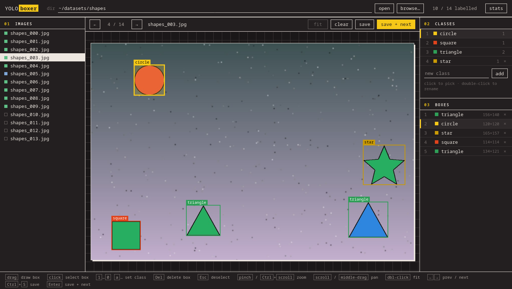

# YOLOboxer
A lightweight, local web app for drawing bounding boxes on images and saving them in
YOLO format. Point it at a folder of images, define your classes, and label with mouse
and keyboard. Labels and `classes.txt` are written to a `labels/` folder next to the
images, ready for YOLO training. No accounts, no cloud, no build step.

Next to it, [YOLOtiler](#yolotiler) cuts the labelled images into smaller, overlapping
tiles and shows you beforehand what happens to every box.



## Run

```sh
python -m venv .venv
.venv/bin/pip install -r requirements.txt
.venv/bin/python yoloboxer.py [IMAGE_DIR] [--port 8000]
```

Open http://127.0.0.1:8000, pick an image directory (type the path or use *browse…*),
add your classes in the right panel and start drawing boxes.

## Run with Docker

The image directory is mounted into the container at `/data`, and labels are written to
`/data/labels`, which is the `labels/` folder next to your images on the host.

```sh
IMAGES_DIR=/path/to/images docker compose up --build
```

Then open http://127.0.0.1:8000 for YOLOboxer and http://127.0.0.1:8001 for YOLOtiler.
`PORT` and `TILER_PORT` change the host ports. Label files are written as
UID/GID 1000 by default; if your user has a different id, run
`UID=$(id -u) GID=$(id -g) IMAGES_DIR=... docker compose up --build`.

Without Compose:

```sh
docker build -t yoloboxer .
docker run --rm -p 127.0.0.1:8000:8000 --user "$(id -u):$(id -g)" \
  -v /path/to/images:/data yoloboxer
```

Inside the container only `/data` (and what you mount) is visible, so the directory
browser shows container paths, not host paths.

## Output

Labels are written next to the images:

```
IMAGE_DIR/
  img001.jpg
  labels/
    classes.txt     one class name per line; line number = class id
    img001.txt      one box per line: class cx cy w h (normalised 0-1)
```

An image saved with no boxes gets an empty label file and counts as labelled (a background
image); it is marked blue instead of green in the image list.

The **stats** button in the top bar shows the dataset at a glance: images with boxes,
saved without boxes and unlabelled, the number of instances (and images) per class, and the
average object size in pixels (box area, overall and per class, with the side of a square of
the same area). It counts saved label files only.

## Keys

| key | action |
| --- | --- |
| drag | draw a box with the current class |
| click | select a box |
| `1`…`0`, `a`…`z` | pick class / re-class the selected box |
| `Del` / `Backspace` | delete selected box |
| `Esc` | deselect |
| pinch / `Ctrl`+scroll, `+` `-` | zoom in / out |
| two-finger scroll / middle-drag | pan the zoomed image |
| double-click / *fit* button | reset zoom |
| `←` `→` | previous / next image |
| `Ctrl+S` | save |
| `Enter` | save + next |

## YOLOtiler

Large images with small objects train better when cut into tiles at the model's input size.
YOLOtiler shows the tile grid on every image of a directory, lets you tune it, and exports
the tiles with their labels clipped to each tile.

```sh
.venv/bin/python yolotiler.py [IMAGE_DIR] [--port 8001]
```

Open http://127.0.0.1:8001 and pick the same image directory you labelled in YOLOboxer.

- **size** and **overlap** (px, separately for x and y) set the grid. Overlap regions are
  shaded on the image; the last tile in a row or column is moved back to end at the image
  edge, so it overlaps its neighbour more than asked (the panel tells you how much). An
  image smaller than the tile becomes a single tile of its own size.
- **keep box ≥ N % visible** decides what happens to a box cut by a tile edge: it is kept,
  clipped to the tile, if at least N % of its area is inside, and dropped otherwise.
- The **tile** view (double-click a tile, or `Space`) shows one tile close up, with the rest
  of the image dimmed, the strips it shares with its neighbours, every kept box clipped to
  the tile with its visible share, the box's original extent dashed, and dropped boxes in grey.
- **export tiles…** writes the tiles in YOLOboxer's layout, so the output opens in YOLOboxer:

```
OUT/                          default IMAGE_DIR/tiles
  img001_x0_y0.jpg            tile cut at pixel (left, top) of img001.jpg
  labels/
    classes.txt               copied from IMAGE_DIR/labels
    img001_x0_y0.txt          clipped boxes, normalised to the tile
  tiling.json                 the settings used
```

By default only images with a label file are exported; an image without one gives tiles
without label files. *skip tiles without boxes* leaves out background tiles.

| key | action |
| --- | --- |
| click | select a tile |
| double-click / `Space` | tile view / back |
| `Esc` | image view |
| `[` `]` | previous / next tile |
| `Shift`+arrows | neighbouring tile |
| pinch / `Ctrl`+scroll, `+` `-` | zoom in / out |
| scroll / drag | pan the zoomed view |
| `F` / *fit* button | reset zoom |
| `←` `→` | previous / next image |

## Code layout

- `yoloboxer.py` – FastAPI backend (directory browsing, images, labels, classes)
- `static/index.html`, `static/style.css`, `static/app.js` – the UI, plain HTML/CSS/JS, no build step
- `yolotiler.py` – YOLOtiler backend (image sizes, tiling, export); reuses `yoloboxer.py`
- `static/tiler.html`, `static/tiler.css`, `static/tiler.js` – the YOLOtiler UI, on top of `style.css`
